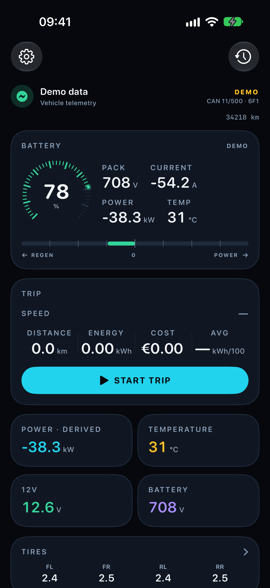
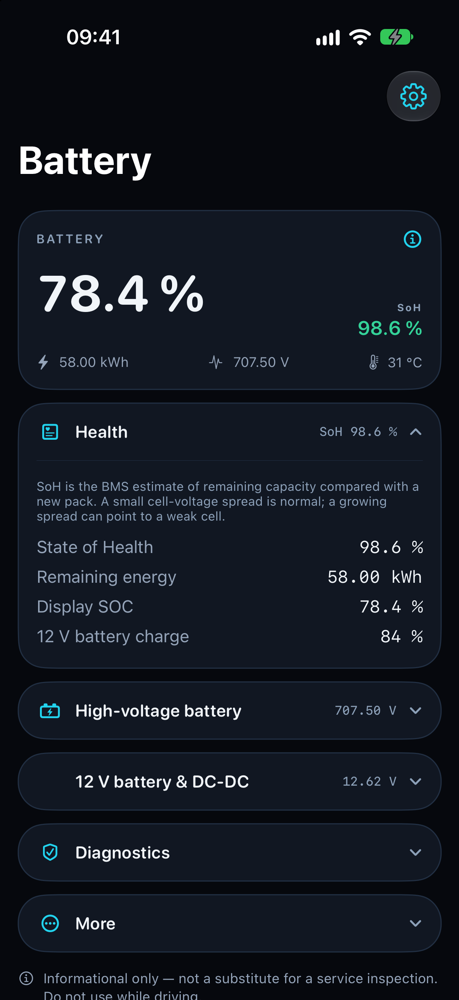
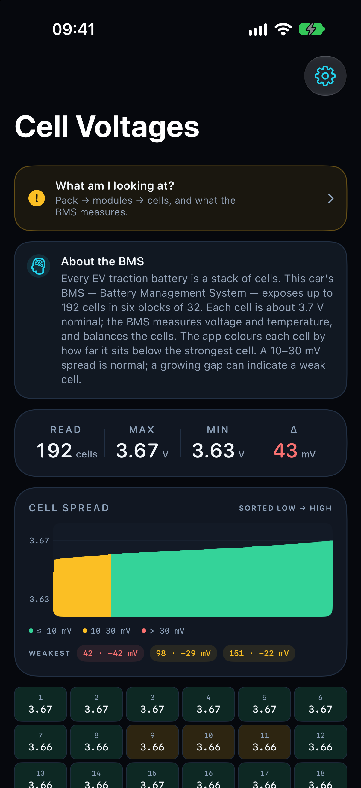
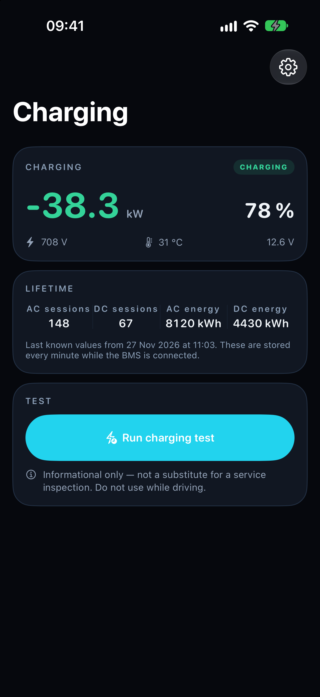
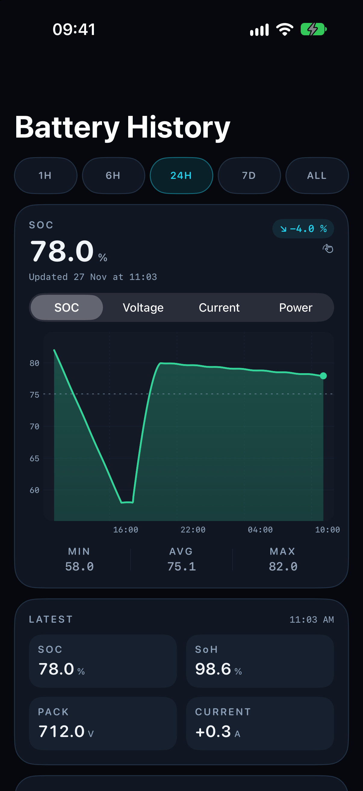

<div align="center">

# EV Info

[](https://github.com/psugarev/ev-info/actions/workflows/ci.yml)
[](LICENSE)
[](LICENSE)

**See what your EV's battery is really doing — all 192 cells, on your iPhone, with nothing uploaded.**

Read-only OBD2 telemetry for the Hyundai Ioniq 5 / E-GMP family, built with SwiftUI.


*Demo mode — sample data, no car needed.*

</div>

---

## Screens

<table>
  <tr>
    <td align="center"><br><b>Drive</b><br>SOC gauge, power, trip, tires</td>
    <td align="center"><br><b>Battery</b><br>SoH, energy, 12 V / LDC</td>
    <td align="center"><br><b>Cells</b><br>192 voltages, weakest cells</td>
    <td align="center"><br><b>Charging</b><br>live power, AC/DC lifetime</td>
    <td align="center"><br><b>History</b><br>SOC / V / A / kW over time</td>
  </tr>
</table>

A sixth tab, **Costs**, prices every trip with an editable Bulgarian day/night
electricity tariff.

## Why it exists

- **192-cell BMS view** — per-cell voltages, spread chart and the three weakest
  cells. Generic OBD apps don't show this for E-GMP cars.
- **Real local cost** — editable Bulgarian day/night tariff (network charges and
  VAT included), not a guessed average.
- **Read-only and private** — it never sends control, coding or clear-fault
  commands, has no account and no server, and keeps everything on the phone.

## Try it without a car

Settings → **Demo mode** (off by default) replaces live data with a recorded
sample session and a day of battery history. Everything is labelled `DEMO`, and
demo data is never mixed with real vehicle data. On a fresh install the Drive
tab also offers a **Use demo data** button.

## Features

**Vehicle data**
- BLE connection to a vLinker / iCar ELM327 adapter (known UART profiles only,
  verified before any command is sent), remembered for automatic reconnect.
- ELM327 init, protocol detection, supported-PID discovery, header-aware request
  queue with timeout resync, ISO-TP multi-frame reassembly.
- Hyundai BMS decoding: SOC, pack voltage/current, temperatures, cell min/max,
  12 V battery, SoH, remaining energy, lifetime AC/DC charge counters, LDC.
- Cell voltages from six BMS DIDs (up to 192 cells): six labelled module
  blocks with their own min/max/spread and balance chip, strongest/weakest
  highlight, weakest-cell ranking, tap-to-detail sheet and a sorted spread
  chart with per-band counts.
- VIN, odometer, tire pressures and temperatures (shown in bar).
- Raw frames are preserved so future decoders can re-read old trips.

**Honest data**
- Values the app cannot read show `—`, never a plausible-looking zero.
- Values go grey with a `STALE` chip within seconds of the adapter going silent.
- Battery values are labelled `BMS · CANDIDATE` and power `DERIVED` until they
  are cluster-correlated; speed carries a `GPS`/`OBD` source chip.

**Trips and costs**
- Trip recording with GPS fallback, local trip summary (when, where, distance,
  time, speed, energy, cost, stops), day/night tariff cost.
- Battery history chart with 1H / 6H / 24H / 7D / ALL ranges and point inspection.
- Battery and charging self-tests (informational; see Safety).
- JSON / CSV export, generated on demand off the main thread.

**Storage and privacy**
- Retention setting (30 / 90 / 365 days / forever), cascade delete of a trip's
  raw frames, and *Delete all data*.
- Versioned SwiftData schema with a migration plan.
- English / Bulgarian UI with a Settings language switch (dynamic status and
  diagnostic strings are still English — see the roadmap).

## Not validated yet

- Cluster correlation of the BMS values against the car's dashboard.
- OBD speed/RPM/throttle: this car's `0100` bitmap advertises only PIDs `01` and
  `20`, so speed uses GPS until a physical ECU request or Hyundai DID is confirmed.
- Auto-reconnect, the Bluetooth-denied flow and background behaviour on a real
  iPhone. Background location was dropped for v1 (foreground trip recording only).

## Ideas & roadmap

The live backlog is in **[GitHub Issues](https://github.com/psugarev/ev-info/issues)**
(labels `P0` / `P1` / `P2`). Highlights:

| Next | Then | Ideas |
|---|---|---|
| Connect-flow polish + real-car check ([#5](https://github.com/psugarev/ev-info/issues/5)) | Cell-grid redesign: six 32-cell module blocks ([#6](https://github.com/psugarev/ev-info/issues/6)) | Home-screen widgets and App Intents ("SOC", "start trip") |
| Localise dynamic strings ([#3](https://github.com/psugarev/ev-info/issues/3)) | Charge-session log with cost ([#7](https://github.com/psugarev/ev-info/issues/7)) | Local notifications: charge complete, 12 V low, tire low |
| Demo-mode App Store screenshots ([#2](https://github.com/psugarev/ev-info/issues/2)) | Read-only fault-code scan, never clearing ([#8](https://github.com/psugarev/ev-info/issues/8)) | State-of-health degradation tracker (SoH vs km) |
| Dynamic Type and accessibility ([#4](https://github.com/psugarev/ev-info/issues/4)) | Units: metric/imperial, bar/psi ([#9](https://github.com/psugarev/ev-info/issues/9)) | Glance / driving mode, daylight theme ([#11](https://github.com/psugarev/ev-info/issues/11)) |
| | Per-trip CSV/GPX export and backup ([#10](https://github.com/psugarev/ev-info/issues/10)) | Landscape layout, Apple Watch, iPad; CarPlay stays a constrained UI |

Monetisation idea (not decided): free live view, one-time Pro unlock for history,
cell analytics and cost engine — no subscription, no tip jar.

## Build

Requires Xcode 27, iOS 17.6+. The Xcode project is generated from `project.yml`
with [XcodeGen](https://github.com/yonaskolb/XcodeGen):

```sh
brew install xcodegen
xcodegen generate
open IoniqDrive.xcodeproj   # pick the IoniqDrive scheme, set your signing team, Run
```

The app installs as **EV Info** (`com.evinfo.app`). Change `CFBundleDisplayName`
and `PRODUCT_BUNDLE_IDENTIFIER` in `project.yml`, then regenerate, for a different
name. Never hand-edit `Resources/Info.plist`.

`Package.swift` builds the core logic and tests only; the app target compiles all
sources directly.

**Simulator QA (Debug builds):** `-demoModeEnabled YES -disclaimerAccepted YES`
turns on demo mode and skips the first-run notice; add
`-demoRoute drive|battery|cells|charging|history` to open one screen directly
(`-demoScrollBottom` scrolls the history screen). The legacy `-demo` flag still
works. Release builds and the real BLE path are untouched.

## Test

```sh
swift test --disable-sandbox
```

`--disable-sandbox` is only needed inside an already-sandboxed shell (e.g. an AI
agent); a normal terminal can run plain `swift test`.

Current result: **84 tests, 0 failures**. See `DESIGN.md` for the visual system,
`OBD_PROTOCOL.md` for the PID map and `TEST_RESULTS.md` for coverage.

## Electricity pricing

The default Bulgarian tariff profile is based on a supplied EVN invoice
(09.09.2026–08.10.2026): day €0.09297/kWh, night €0.04103/kWh, network charges
€0.03585/kWh, 20 % VAT. The app adds network and VAT instead of hard-coding the
€0.13267/kWh blended figure. All components are editable in the Costs tab.

## Safety

The app is **read-only**: it never sends actuator, coding or clear-diagnostic
commands. Battery and diagnostic results are informational estimates from
manufacturer-specific data that has not been validated against the car; they are
not a substitute for a service inspection. Do not use the app while driving.

## Sharing with friends

`Distribution/` contains an unsigned IPA plus guides for installing it with a
free Apple ID (Sideloadly / AltStore / SideStore). Free-account signatures last
7 days and allow 3 apps per device; TestFlight/App Store need the paid Apple
Developer Program. See `Distribution/README.md`. App Store drafts live there too:
`PRIVACY_POLICY.md` and `APP_REVIEW_NOTES.md`.

## CarPlay

A normal app cannot draw an arbitrary dashboard on the factory screen. The phone
is the primary UI; see `Sources/CarPlay/README.md`.

## License

**MIT** — see [`LICENSE`](LICENSE). In short: use it, fork it, learn from it,
ship your own build; keep the copyright notice.

Third-party marks are not part of the licence: *Hyundai*, *Ioniq* and *Bluetooth*
belong to their owners, and EV Info is not affiliated with or endorsed by Hyundai
Motor Company. The app icon is an original motif (a green power-up mushroom with
an EV bolt), not artwork from any game. The OBD2 code is read-only by design: no
actuator, coding or clear-fault commands, and no warranty for anything it reports
on your car.

## Working on this repo (humans and AI agents)

Start with **[`HANDOFF.md`](HANDOFF.md)** — current state, open work, gotchas and
the workflow: one branch per task (`agent/<name>/<topic>`), one PR per task,
commit trailers naming the agent, and a session-log row before you finish.
Hard rules for the vehicle code are in [`AGENTS.md`](AGENTS.md). The App Store
readiness plan is [`APP_STORE_AUDIT.md`](APP_STORE_AUDIT.md).

---

*EV Info is not affiliated with or endorsed by Hyundai Motor Company. Hyundai and
Ioniq are trademarks of Hyundai Motor Company.*
